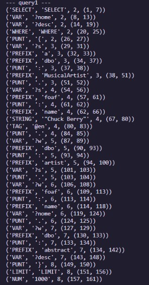
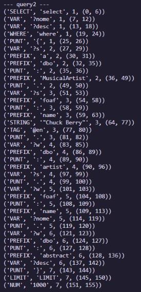

# TPC 3: Analisador Léxico

## Autor
Feito por Rita Machado, A108400


## Resumo
Este trabalho teve como objetivo construir um analisador léxico para uma linguagem de query com a qual é possível escrever frases do género:
```
# DBPedia: obras de Chuck Berry

select ?nome ?desc where {
?s a dbo:MusicalArtist.
?s foaf:name "Chuck Berry"@en .
?w dbo:artist ?s.
?w foaf:name ?nome.
?w dbo:abstract ?desc
} LIMIT 1000
```

Para tal, foram definidos tokens para cada expressão regular com o seu próprio id, de maneira a respeitar as seguintes regras:
- O caráter '#' marca o início de um comentário que se prolonga até ao fim da linha e deve ser ignorado;
- O caráter '?' marca o início de um identificador de uma variável que se prolonga até ao primeiro caráter não alfanumérico;
- O caráter '@' marca o início de um identificador de língua que terá mais 2 carateres;
- Qualquer sequência entre aspas é um valor do tipo string;
- As outras sequências de alfanuméricos são identificadores de conceitos;
- Os carateres '{}.' são delimitadores;
- 'LIMIT' é uma palavra reservada;

## Lista de Resultados
- [Analisador Léxico](analisador.py)
- Print do resultado da query 1

- Print do resultado da query 2
